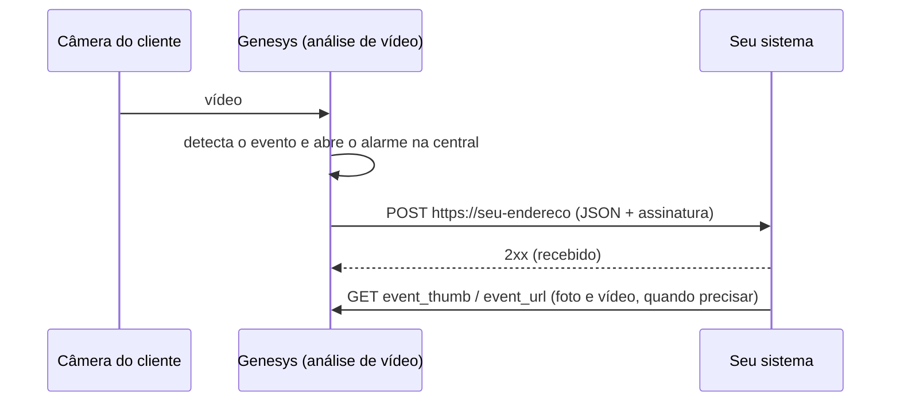

# Integração Genesys — manual do desenvolvedor

**Versão 1.0 · 20/10/2026 · Cognia** · Suporte: **moraginski@gmail.com**

A Integração Genesys entrega, em tempo real, cada evento de vídeo analisado pela Genesys ao sistema da sua empresa.
Para cada evento, a Genesys faz um `POST` HTTPS com um JSON que traz o tipo do evento, o local, a câmera, a hora, o link
da foto e o link da página com o vídeo.

Este manual é para quem vai **receber** os eventos: o time de desenvolvimento do software de monitoramento, da central
de operações ou do sistema que vai consumir o alerta.

---

## Sumário

1. [Como funciona](#1-como-funciona)
2. [Início rápido](#2-início-rápido)
3. [Cadastro, liga/desliga e evento de teste](#3-cadastro-ligadesliga-e-evento-de-teste)
4. [A requisição](#4-a-requisição)
5. [Campos do JSON](#5-campos-do-json)
6. [Tipos de evento](#6-tipos-de-evento)
7. [Exemplos, um por tipo](#7-exemplos-um-por-tipo)
8. [Foto e vídeo](#8-foto-e-vídeo)
9. [Resposta, retentativas e prazos](#9-resposta-retentativas-e-prazos)
10. [Ordem e duplicidade](#10-ordem-e-duplicidade)
11. [Segurança e verificação da assinatura](#11-segurança-e-verificação-da-assinatura)
12. [Receptor completo de exemplo](#12-receptor-completo-de-exemplo)
13. [Testar o seu receptor sem a Genesys](#13-testar-o-seu-receptor-sem-a-genesys)
14. [Solução de problemas](#14-solução-de-problemas)
15. [Perguntas frequentes](#15-perguntas-frequentes)
16. [Compatibilidade](#16-compatibilidade)
17. [Histórico de versões](#17-histórico-de-versões)
18. [Suporte](#18-suporte)

---

## 1. Como funciona



1. A câmera do cliente gera um evento (pessoa, veículo, placa em lista, permanência etc.), e a análise da Genesys o
   transforma em alarme na central de operações.
2. **Todo evento que vira alarme na central também é enviado a você.** A Genesys não filtra por tipo nem por confiança:
   você recebe todos e decide o que usar.
3. O envio sai poucos segundos depois do evento (em geral em até 30 s).
4. O seu sistema responde `2xx` e o evento está entregue. Se não responder, a Genesys tenta de novo (seção 9).
5. A foto e o vídeo ficam disponíveis por **7 dias** pelos links do JSON, sem login.

A integração é ligada **por cliente** (local monitorado). Cada cliente tem o seu endereço e o seu token. Um evento de um
cliente só vai para o endereço cadastrado naquele cliente.

---

## 2. Início rápido

1. **Publique um endereço HTTPS** que aceite `POST` com JSON, por exemplo `https://eventos.suaempresa.com.br/genesys`.
   O certificado precisa ser válido para o nome do endereço.
2. **Combine um token** com a revenda que atende você: um texto secreto de 1 a 200 caracteres, como uma senha longa.
3. **A revenda cadastra** o endereço e o token na ficha do cliente (seção 3) e clica em **Enviar evento de teste**.
4. **No seu sistema**, confira o token ou a assinatura (seção 11), responda `200` rápido e grave o evento.
5. **Deduplique** por `event_id` (seção 10). Pronto.

---

## 3. Cadastro, liga/desliga e evento de teste

O cadastro é feito pela revenda, no portal Cognia: **Clientes → ficha do cliente → aba Identidade → Integração Genesys**.

| campo na tela | no JSON | regra |
|---|---|---|
| Endereço | — | `https://` obrigatório; host público (sem IP interno, sem usuário/senha na URL). Pode ter caminho e porta (`https://host:8443/caminho`). Redirecionamento não é seguido. |
| Chave de acesso | `token` | 1 a 200 caracteres. Depois de salva, a tela mostra só "definida" e nunca mais a exibe. |
| Ligada / Desligada | — | Desligar pausa o envio **sem apagar** o endereço nem a chave. Religar não pede a chave de novo. |

- Mudanças (endereço, chave, ligar ou desligar) valem em **até 15 minutos**.
- Ao **desligar**, os envios ainda pendentes daquele cliente são cancelados.
- Ao **religar**, só os eventos novos são enviados. O período desligado não é reenviado.

### Evento de teste

O botão **Enviar evento de teste** fica na aba **Automode** da ficha do cliente (a seção Integração Genesys tem um
atalho para ela). Ele manda um evento fictício pelo mesmo caminho e com a mesma assinatura do envio real, e mostra o
resultado na tela:

| resultado na tela | o que significa |
|---|---|
| Aceito | o seu sistema respondeu `2xx` |
| Recusado | o seu sistema respondeu `4xx` (veja o código) |
| Erro no servidor | o seu sistema respondeu `5xx` |
| Tempo esgotado | sem resposta em 10 s |
| Falha de TLS/DNS | o nome não resolve, o certificado é inválido ou não confere com o nome |
| Endereço não público | o nome resolve para um endereço interno (rede privada, localhost) |

O texto da resposta do seu sistema não é exibido nem guardado: só o código HTTP.

Como reconhecer o evento de teste:

- `camera_name` = `"TESTE Cognia"`;
- `camera_id` termina em `-TESTE`;
- `event_id` termina em `-teste-AAAAMMDDHHMMSS`.

Os links `event_url` e `event_thumb` do teste respondem `404` de propósito, porque não existe evento real por trás.

```json
{
  "event_id": "BX-0002-COG-01-teste-20261020143005",
  "camera_id": "BX-0002-COG-01-TESTE",
  "client_id": "detectia__residencial_aurora",
  "camera_name": "TESTE Cognia",
  "event_at": "2026-10-20 11:30:05",
  "token": "seu-token",
  "event_description": "Detecção de pessoas",
  "camera_address": "Rua Exemplo, 100 - Centro, Campinas - SP, 13010-000",
  "app_client_id": 0,
  "event_url": "https://det.cogniagenesys.com.br/p/e/teste",
  "event_thumb": "https://det.cogniagenesys.com.br/p/e/teste",
  "client_name": "Residencial Aurora",
  "client_document_number": "",
  "client_address": "Rua Exemplo, 100 - Centro, Campinas - SP, 13010-000",
  "event_type_id": 1
}
```

---

## 4. A requisição

```
POST <seu endereço>
Content-Type: application/json
User-Agent: cognia-box-webhook/1
X-Cognia-Ts: 1760970605
X-Cognia-Assinatura: sha256=3f1c0e4b7a9d2c5e8f6a1b0d3c7e9f2a4b6c8d0e1f3a5b7c9d2e4f6a8b0c1d3e
```

| cabeçalho | conteúdo |
|---|---|
| `Content-Type` | sempre `application/json` |
| `User-Agent` | `cognia-box-webhook/1` (o número muda se o formato mudar de forma incompatível) |
| `X-Cognia-Ts` | hora do envio, em segundos desde 1970 (UTC). Muda a cada tentativa. |
| `X-Cognia-Assinatura` | `sha256=` + HMAC-SHA256 em hexadecimal minúsculo de `"<X-Cognia-Ts>.<corpo>"` com o token como chave (seção 11) |

- **Corpo:** um único objeto JSON por requisição (nunca lista), em UTF-8. Acentos vêm como caracteres, não como `ç`.
- **Tamanho:** em torno de 1 KB. Não há foto nem vídeo dentro do JSON, só links.
- **Uma requisição por evento.** Não há agrupamento em lote.
- **Origem:** cada central Genesys envia da própria rede, então o IP de origem varia de cliente para cliente e pode
  mudar. Não use liberação por IP como única proteção.

---

## 5. Campos do JSON

Todos os campos vêm em todos os eventos, exceto `plate`, que só vem nos tipos de placa.

| campo | tipo | descrição | exemplo |
|---|---|---|---|
| `event_id` | texto | Id único do evento. **Igual em todas as retentativas.** Use para deduplicar. | `"BX-0002-COG-01-48213"` |
| `event_type_id` | inteiro | Código do tipo de evento (seção 6). | `1` |
| `event_description` | texto | Nome do tipo de evento, em português (seção 6). | `"Detecção de pessoas"` |
| `event_at` | texto | Data e hora do evento, `AAAA-MM-DD HH:MM:SS`, **horário de Brasília** (America/Sao_Paulo), sem fuso no texto. | `"2026-10-19 23:14:05"` |
| `camera_id` | texto | Id da câmera. Estável: a mesma câmera manda sempre o mesmo id. | `"BX-0002-COG-01-cam133"` |
| `camera_name` | texto | Nome da câmera, como cadastrado na Genesys. | `"Portão social"` |
| `camera_address` | texto | Endereço do local da câmera (hoje, o mesmo do cliente). | `"Rua Exemplo, 100 - Centro, Campinas - SP, 13010-000"` |
| `client_id` | texto | Id do cliente (local monitorado). Estável. | `"detectia__residencial_aurora"` |
| `client_name` | texto | Nome do cliente. | `"Residencial Aurora"` |
| `client_address` | texto | Endereço do cliente. | `"Rua Exemplo, 100 - Centro, Campinas - SP, 13010-000"` |
| `client_document_number` | texto | Sempre `""`. A Genesys não envia CPF nem CNPJ. | `""` |
| `app_client_id` | inteiro | Sempre `0`. Mantido para compatibilidade. | `0` |
| `token` | texto | O token cadastrado para este cliente. | `"seu-token"` |
| `event_url` | texto | Página do evento com foto e vídeo, sem login, válida por 7 dias. | `"https://…/p/e/48213/pagina?exp=…&sig=…"` |
| `event_thumb` | texto | Foto do evento (JPEG), sem login, válida por 7 dias. | `"https://…/p/e/48213/foto?exp=…&sig=…"` |
| `plate` | texto | **Só nos tipos 13 e 26.** A placa como o leitor de placas a registrou. Pode vir `""` se a leitura não foi registrada. | `"ABC1D23"` |

Regras para o seu código:

- **Ids são textos opacos.** Não tente extrair número, box ou câmera de dentro deles, porque o formato pode mudar.
- **Endereço** pode vir `""` se o cliente não tem endereço cadastrado.
- **Campos novos** podem ser acrescentados no futuro. O seu sistema deve ignorar campos que não conhece em vez de recusar.
- **A ordem das chaves** no JSON não é garantida.

---

## 6. Tipos de evento

Os códigos de 1 a 19 seguem a numeração que o mercado de monitoramento já usa. Os tipos da Genesys sem equivalente
começam em 20.

| `event_type_id` | `event_description` | o que aconteceu | traz `plate` |
|---|---|---|---|
| 1 | Detecção de pessoas | pessoa detectada numa área monitorada | não |
| 3 | Detecção de ausência | o posto que deveria estar ocupado (portaria, guarita) ficou vazio | não |
| 5 | Detecção de aglomeração | mais pessoas que o limite configurado na mesma área | não |
| 13 | Carro na lista de alertas | placa lida que está na lista de alerta do cliente | sim |
| 20 | Detecção de veículo | veículo detectado numa área monitorada | não |
| 21 | Detecção de animal | animal detectado numa área monitorada | não |
| 22 | Cruzamento de linha | alguém ou algo cruzou uma linha virtual configurada | não |
| 23 | Abandono de posto | o responsável saiu do posto e não voltou no tempo configurado | não |
| 24 | Permanência | pessoa parada numa área além do tempo configurado | não |
| 25 | Surto de detecções | muitas detecções seguidas na mesma câmera em pouco tempo | não |
| 26 | Placa parada | veículo com placa lida parado além do tempo configurado | sim |

**Previstos (ainda não enviados):** `11` Câmera offline e `16` Mudança de cena (câmera virada, tapada ou com imagem
preta). Prepare o seu sistema para aceitar códigos que ele ainda não conhece, por exemplo tratando como "outro evento"
e usando o texto de `event_description`.

Os tipos que chegam de cada cliente dependem dos analíticos contratados para cada câmera.

---

## 7. Exemplos, um por tipo

Os exemplos usam um cliente fictício. Os links estão encurtados com `…`; os reais trazem `exp` e `sig` completos.

<details open>
<summary><b>1 · Detecção de pessoas</b></summary>

```json
{
  "event_id": "BX-0002-COG-01-48213",
  "camera_id": "BX-0002-COG-01-cam133",
  "client_id": "detectia__residencial_aurora",
  "camera_name": "Portão social",
  "event_at": "2026-10-19 23:14:05",
  "token": "seu-token",
  "event_description": "Detecção de pessoas",
  "camera_address": "Rua Exemplo, 100 - Centro, Campinas - SP, 13010-000",
  "app_client_id": 0,
  "event_url": "https://det.cogniagenesys.com.br/p/e/48213/pagina?exp=1761531245&sig=9f2c…",
  "event_thumb": "https://det.cogniagenesys.com.br/p/e/48213/foto?exp=1761531245&sig=1ab7…",
  "client_name": "Residencial Aurora",
  "client_document_number": "",
  "client_address": "Rua Exemplo, 100 - Centro, Campinas - SP, 13010-000",
  "event_type_id": 1
}
```
</details>

<details>
<summary><b>3 · Detecção de ausência</b></summary>

```json
{
  "event_id": "BX-0002-COG-01-48214",
  "camera_id": "BX-0002-COG-01-cam120",
  "client_id": "detectia__residencial_aurora",
  "camera_name": "Guarita",
  "event_at": "2026-10-19 02:41:10",
  "token": "seu-token",
  "event_description": "Detecção de ausência",
  "camera_address": "Rua Exemplo, 100 - Centro, Campinas - SP, 13010-000",
  "app_client_id": 0,
  "event_url": "https://det.cogniagenesys.com.br/p/e/48214/pagina?exp=…&sig=…",
  "event_thumb": "https://det.cogniagenesys.com.br/p/e/48214/foto?exp=…&sig=…",
  "client_name": "Residencial Aurora",
  "client_document_number": "",
  "client_address": "Rua Exemplo, 100 - Centro, Campinas - SP, 13010-000",
  "event_type_id": 3
}
```
</details>

<details>
<summary><b>5 · Detecção de aglomeração</b></summary>

```json
{
  "event_id": "BX-0002-COG-01-48215",
  "camera_id": "BX-0002-COG-01-cam131",
  "client_id": "detectia__residencial_aurora",
  "camera_name": "Salão de festas",
  "event_at": "2026-10-19 01:05:44",
  "token": "seu-token",
  "event_description": "Detecção de aglomeração",
  "camera_address": "Rua Exemplo, 100 - Centro, Campinas - SP, 13010-000",
  "app_client_id": 0,
  "event_url": "https://det.cogniagenesys.com.br/p/e/48215/pagina?exp=…&sig=…",
  "event_thumb": "https://det.cogniagenesys.com.br/p/e/48215/foto?exp=…&sig=…",
  "client_name": "Residencial Aurora",
  "client_document_number": "",
  "client_address": "Rua Exemplo, 100 - Centro, Campinas - SP, 13010-000",
  "event_type_id": 5
}
```
</details>

<details>
<summary><b>13 · Carro na lista de alertas</b> (traz <code>plate</code>)</summary>

```json
{
  "event_id": "BX-0002-COG-01-48230",
  "camera_id": "BX-0002-COG-01-cam140",
  "client_id": "detectia__residencial_aurora",
  "camera_name": "LPR entrada",
  "event_at": "2026-10-19 23:20:41",
  "token": "seu-token",
  "event_description": "Carro na lista de alertas",
  "camera_address": "Rua Exemplo, 100 - Centro, Campinas - SP, 13010-000",
  "app_client_id": 0,
  "event_url": "https://det.cogniagenesys.com.br/p/e/48230/pagina?exp=…&sig=…",
  "event_thumb": "https://det.cogniagenesys.com.br/p/e/48230/foto?exp=…&sig=…",
  "client_name": "Residencial Aurora",
  "client_document_number": "",
  "client_address": "Rua Exemplo, 100 - Centro, Campinas - SP, 13010-000",
  "event_type_id": 13,
  "plate": "ABC1D23"
}
```
</details>

<details>
<summary><b>20 · Detecção de veículo</b></summary>

```json
{
  "event_id": "BX-0002-COG-01-48231",
  "camera_id": "BX-0002-COG-01-cam135",
  "client_id": "detectia__residencial_aurora",
  "camera_name": "Estacionamento",
  "event_at": "2026-10-19 03:12:09",
  "token": "seu-token",
  "event_description": "Detecção de veículo",
  "camera_address": "Rua Exemplo, 100 - Centro, Campinas - SP, 13010-000",
  "app_client_id": 0,
  "event_url": "https://det.cogniagenesys.com.br/p/e/48231/pagina?exp=…&sig=…",
  "event_thumb": "https://det.cogniagenesys.com.br/p/e/48231/foto?exp=…&sig=…",
  "client_name": "Residencial Aurora",
  "client_document_number": "",
  "client_address": "Rua Exemplo, 100 - Centro, Campinas - SP, 13010-000",
  "event_type_id": 20
}
```
</details>

<details>
<summary><b>21 · Detecção de animal</b></summary>

```json
{
  "event_id": "BX-0002-COG-01-48232",
  "camera_id": "BX-0002-COG-01-cam137",
  "client_id": "detectia__residencial_aurora",
  "camera_name": "Muro fundos",
  "event_at": "2026-10-19 04:02:51",
  "token": "seu-token",
  "event_description": "Detecção de animal",
  "camera_address": "Rua Exemplo, 100 - Centro, Campinas - SP, 13010-000",
  "app_client_id": 0,
  "event_url": "https://det.cogniagenesys.com.br/p/e/48232/pagina?exp=…&sig=…",
  "event_thumb": "https://det.cogniagenesys.com.br/p/e/48232/foto?exp=…&sig=…",
  "client_name": "Residencial Aurora",
  "client_document_number": "",
  "client_address": "Rua Exemplo, 100 - Centro, Campinas - SP, 13010-000",
  "event_type_id": 21
}
```
</details>

<details>
<summary><b>22 · Cruzamento de linha</b></summary>

```json
{
  "event_id": "BX-0002-COG-01-48233",
  "camera_id": "BX-0002-COG-01-cam137",
  "client_id": "detectia__residencial_aurora",
  "camera_name": "Muro fundos",
  "event_at": "2026-10-19 00:47:30",
  "token": "seu-token",
  "event_description": "Cruzamento de linha",
  "camera_address": "Rua Exemplo, 100 - Centro, Campinas - SP, 13010-000",
  "app_client_id": 0,
  "event_url": "https://det.cogniagenesys.com.br/p/e/48233/pagina?exp=…&sig=…",
  "event_thumb": "https://det.cogniagenesys.com.br/p/e/48233/foto?exp=…&sig=…",
  "client_name": "Residencial Aurora",
  "client_document_number": "",
  "client_address": "Rua Exemplo, 100 - Centro, Campinas - SP, 13010-000",
  "event_type_id": 22
}
```
</details>

<details>
<summary><b>23 · Abandono de posto</b></summary>

```json
{
  "event_id": "BX-0002-COG-01-48234",
  "camera_id": "BX-0002-COG-01-cam120",
  "client_id": "detectia__residencial_aurora",
  "camera_name": "Guarita",
  "event_at": "2026-10-19 03:55:02",
  "token": "seu-token",
  "event_description": "Abandono de posto",
  "camera_address": "Rua Exemplo, 100 - Centro, Campinas - SP, 13010-000",
  "app_client_id": 0,
  "event_url": "https://det.cogniagenesys.com.br/p/e/48234/pagina?exp=…&sig=…",
  "event_thumb": "https://det.cogniagenesys.com.br/p/e/48234/foto?exp=…&sig=…",
  "client_name": "Residencial Aurora",
  "client_document_number": "",
  "client_address": "Rua Exemplo, 100 - Centro, Campinas - SP, 13010-000",
  "event_type_id": 23
}
```
</details>

<details>
<summary><b>24 · Permanência</b></summary>

```json
{
  "event_id": "BX-0002-COG-01-48235",
  "camera_id": "BX-0002-COG-01-cam133",
  "client_id": "detectia__residencial_aurora",
  "camera_name": "Portão social",
  "event_at": "2026-10-19 22:18:37",
  "token": "seu-token",
  "event_description": "Permanência",
  "camera_address": "Rua Exemplo, 100 - Centro, Campinas - SP, 13010-000",
  "app_client_id": 0,
  "event_url": "https://det.cogniagenesys.com.br/p/e/48235/pagina?exp=…&sig=…",
  "event_thumb": "https://det.cogniagenesys.com.br/p/e/48235/foto?exp=…&sig=…",
  "client_name": "Residencial Aurora",
  "client_document_number": "",
  "client_address": "Rua Exemplo, 100 - Centro, Campinas - SP, 13010-000",
  "event_type_id": 24
}
```
</details>

<details>
<summary><b>25 · Surto de detecções</b></summary>

```json
{
  "event_id": "BX-0002-COG-01-48236",
  "camera_id": "BX-0002-COG-01-cam131",
  "client_id": "detectia__residencial_aurora",
  "camera_name": "Salão de festas",
  "event_at": "2026-10-19 01:09:15",
  "token": "seu-token",
  "event_description": "Surto de detecções",
  "camera_address": "Rua Exemplo, 100 - Centro, Campinas - SP, 13010-000",
  "app_client_id": 0,
  "event_url": "https://det.cogniagenesys.com.br/p/e/48236/pagina?exp=…&sig=…",
  "event_thumb": "https://det.cogniagenesys.com.br/p/e/48236/foto?exp=…&sig=…",
  "client_name": "Residencial Aurora",
  "client_document_number": "",
  "client_address": "Rua Exemplo, 100 - Centro, Campinas - SP, 13010-000",
  "event_type_id": 25
}
```
</details>

<details>
<summary><b>26 · Placa parada</b> (traz <code>plate</code>)</summary>

```json
{
  "event_id": "BX-0002-COG-01-48237",
  "camera_id": "BX-0002-COG-01-cam140",
  "client_id": "detectia__residencial_aurora",
  "camera_name": "LPR entrada",
  "event_at": "2026-10-19 21:33:48",
  "token": "seu-token",
  "event_description": "Placa parada",
  "camera_address": "Rua Exemplo, 100 - Centro, Campinas - SP, 13010-000",
  "app_client_id": 0,
  "event_url": "https://det.cogniagenesys.com.br/p/e/48237/pagina?exp=…&sig=…",
  "event_thumb": "https://det.cogniagenesys.com.br/p/e/48237/foto?exp=…&sig=…",
  "client_name": "Residencial Aurora",
  "client_document_number": "",
  "client_address": "Rua Exemplo, 100 - Centro, Campinas - SP, 13010-000",
  "event_type_id": 26,
  "plate": "BRA2E19"
}
```
</details>

---

## 8. Foto e vídeo

| link | o que devolve |
|---|---|
| `event_thumb` | a foto do evento, `image/jpeg` |
| `event_url` | uma página com a foto e o vídeo do evento, para abrir no navegador |

- O vídeo é gravado em torno do momento do evento e fica pronto alguns segundos ou minutos depois do envio.
  - Até ficar pronto, a página mostra **"vídeo em processamento (recarregue)"**.
  - Se não ficar pronto em 30 minutos, a página mostra **"vídeo indisponível"**, e só a foto vale.
- Os links valem **7 dias** a partir do evento. Depois disso, ou com qualquer alteração no endereço (`exp`, `sig`,
  número do evento), a resposta é `404`.
- O `404` é o mesmo para todos os motivos: link vencido, adulterado ou de evento que não existe.
- Cada link abre **somente aquele evento**. Não dá acesso a câmera ao vivo, a outros eventos nem ao portal.
- **Para guardar a mídia por mais de 7 dias**, baixe a foto ao receber o evento e abra a página do vídeo dentro do prazo.
- Use os links exatamente como vieram. Não monte links a partir do `event_id`.

---

## 9. Resposta, retentativas e prazos

| a sua resposta | o que a Genesys faz |
|---|---|
| `2xx` (qualquer) | entregue; não envia de novo |
| `408` ou `429` | tenta de novo |
| `5xx` | tenta de novo |
| sem resposta em **10 s** | tenta de novo |
| falha de rede, DNS ou TLS | tenta de novo |
| outro `4xx` (`400`, `401`, `403`, `404`, `422`…) | **desiste** daquele evento |
| `3xx` | não segue o redirecionamento; **desiste** |

**Cronograma das tentativas** (a espera dobra a cada falha, até 1 h entre tentativas, no máximo 10 tentativas):

| tentativa | espera depois da falha anterior | tempo aproximado desde o 1º envio |
|---|---|---|
| 1 | — | 0 |
| 2 | 30 s | 30 s |
| 3 | 1 min | 1 min 30 s |
| 4 | 2 min | 3 min 30 s |
| 5 | 4 min | 7 min 30 s |
| 6 | 8 min | 15 min 30 s |
| 7 | 16 min | 31 min 30 s |
| 8 | 32 min | 1 h 03 min |
| 9 | 1 h | 2 h 03 min |
| 10 | 1 h | 3 h 03 min |

- Depois da 10ª tentativa sem sucesso, o evento é dado como não entregue.
- Nenhum evento é enviado mais de **24 h** depois de acontecer (por exemplo, se a central ficou sem internet).
- **Responda rápido.** Grave o evento numa fila e devolva `200`; processe depois. Resposta lenta vira retentativa e
  evento duplicado.
- **Não use `401`/`403` para erro temporário seu**: a Genesys desiste do evento. Para "tente depois", use `503` ou `429`.

---

## 10. Ordem e duplicidade

- **A entrega é "pelo menos uma vez".** O mesmo evento pode chegar mais de uma vez (por exemplo, se o seu `200` se
  perdeu na rede). Deduplique por `event_id`.
- **A ordem de chegada não é garantida.** Uma retentativa pode chegar depois de um evento mais novo. Ordene por `event_at`.
- Eventos de clientes diferentes chegam de forma independente, mesmo para o mesmo endereço.

---

## 11. Segurança e verificação da assinatura

O seu endereço fica exposto na internet. Confira que cada envio veio da Genesys. Há duas formas; recomendamos a 2.

1. **Token no corpo:** compare o campo `token` do JSON com o token cadastrado.
2. **Assinatura no cabeçalho (recomendado):**
   1. Leia o corpo **exatamente como recebido** (bytes), antes de qualquer parse.
   2. Monte o texto `X-Cognia-Ts` + `"."` + corpo.
   3. Calcule o HMAC-SHA256 desse texto usando o token como chave, em hexadecimal minúsculo.
   4. Compare `"sha256=" + resultado` com `X-Cognia-Assinatura`, em tempo constante.
   5. Recuse se `X-Cognia-Ts` estiver a mais de 5 minutos do seu relógio (proteção contra reenvio de requisição gravada).

Outras regras:

- Só enviamos para `https` com certificado válido para o nome do seu endereço. Certificado autoassinado não funciona.
- O IP de origem varia; não use liberação por IP como única proteção.
- Troque o token (na ficha do cliente) se suspeitar de vazamento. Vale em até 15 minutos.
- **LGPD:** nome e endereço do cliente, placa, foto e vídeo são dados pessoais. Trate-os conforme a sua política de
  privacidade e guarde só pelo tempo necessário.

### Python

```python
import hashlib, hmac, time

def veio_da_genesys(corpo: bytes, ts: str, assinatura: str, token: str) -> bool:
    if not ts.isdigit() or abs(time.time() - int(ts)) > 300:
        return False
    esperado = "sha256=" + hmac.new(token.encode(), ts.encode() + b"." + corpo, hashlib.sha256).hexdigest()
    return hmac.compare_digest(esperado, assinatura or "")
```

### Node.js

```javascript
const crypto = require("crypto");

function veioDaGenesys(corpo /* Buffer */, ts, assinatura, token) {
  if (!/^\d+$/.test(ts || "") || Math.abs(Date.now() / 1000 - Number(ts)) > 300) return false;
  const esperado = "sha256=" + crypto.createHmac("sha256", token).update(`${ts}.`).update(corpo).digest("hex");
  const a = Buffer.from(esperado), b = Buffer.from(assinatura || "");
  return a.length === b.length && crypto.timingSafeEqual(a, b);
}
```

### PHP

```php
<?php
function veio_da_genesys(string $corpo, string $ts, string $assinatura, string $token): bool {
    if (!ctype_digit($ts) || abs(time() - (int)$ts) > 300) {
        return false;
    }
    $esperado = 'sha256=' . hash_hmac('sha256', $ts . '.' . $corpo, $token);
    return hash_equals($esperado, $assinatura);
}

// uso: $corpo = file_get_contents('php://input');
//      $ts = $_SERVER['HTTP_X_COGNIA_TS'] ?? '';
//      $assinatura = $_SERVER['HTTP_X_COGNIA_ASSINATURA'] ?? '';
```

### C# (.NET 6 ou mais novo)

```csharp
using System;
using System.Linq;
using System.Security.Cryptography;
using System.Text;

static bool VeioDaGenesys(byte[] corpo, string ts, string assinatura, string token)
{
    if (!long.TryParse(ts, out var t) || Math.Abs(DateTimeOffset.UtcNow.ToUnixTimeSeconds() - t) > 300)
        return false;
    using var hmac = new HMACSHA256(Encoding.UTF8.GetBytes(token));
    var dados = Encoding.UTF8.GetBytes(ts + ".").Concat(corpo).ToArray();
    var esperado = "sha256=" + Convert.ToHexString(hmac.ComputeHash(dados)).ToLowerInvariant();
    return CryptographicOperations.FixedTimeEquals(
        Encoding.UTF8.GetBytes(esperado), Encoding.UTF8.GetBytes(assinatura ?? ""));
}
```

---

## 12. Receptor completo de exemplo

Um receptor mínimo e correto em Python (Flask). Ele confere a assinatura, deduplica, responde rápido e deixa o
processamento para depois.

```python
import json, os, queue, threading
from flask import Flask, request

TOKEN = os.environ["GENESYS_TOKEN"]          # o mesmo token cadastrado na ficha do cliente
app = Flask(__name__)
fila: "queue.Queue[dict]" = queue.Queue()
vistos: set[str] = set()                     # em produção: tabela com índice único em event_id

@app.post("/genesys")
def recebe():
    corpo = request.get_data()                # bytes crus, ANTES de qualquer parse
    if not veio_da_genesys(corpo, request.headers.get("X-Cognia-Ts", ""),
                           request.headers.get("X-Cognia-Assinatura", ""), TOKEN):
        return "", 401
    evento = json.loads(corpo)
    if evento["event_id"] in vistos:          # retentativa ou duplicado: já temos
        return "", 200
    vistos.add(evento["event_id"])
    fila.put(evento)                          # processa fora da requisição
    return "", 200

def trabalha():
    while True:
        e = fila.get()
        print(e["event_at"], e["event_type_id"], e["event_description"], e["client_name"], e["camera_name"])
        # aqui: abrir o alarme no seu sistema, baixar e["event_thumb"], etc.

threading.Thread(target=trabalha, daemon=True).start()
# veio_da_genesys: a função da seção 11
```

O mesmo em Node.js (Express). Note o `express.raw`, que guarda os bytes crus:

```javascript
const express = require("express");
const app = express();
const TOKEN = process.env.GENESYS_TOKEN;
const vistos = new Set();                    // em produção: índice único em event_id

app.post("/genesys", express.raw({ type: "application/json" }), (req, res) => {
  if (!veioDaGenesys(req.body, req.get("X-Cognia-Ts"), req.get("X-Cognia-Assinatura"), TOKEN)) {
    return res.sendStatus(401);
  }
  const evento = JSON.parse(req.body.toString("utf8"));
  if (vistos.has(evento.event_id)) return res.sendStatus(200);
  vistos.add(evento.event_id);
  setImmediate(() => processa(evento));      // responde já; processa depois
  res.sendStatus(200);
});

function processa(e) {
  console.log(e.event_at, e.event_type_id, e.event_description, e.client_name, e.camera_name);
}

app.listen(8080);
// veioDaGenesys: a função da seção 11
```

---

## 13. Testar o seu receptor sem a Genesys

Este script manda ao seu endereço um evento assinado exatamente como a Genesys assina. Use-o enquanto desenvolve,
antes de pedir o cadastro à revenda.

```python
# uso: GENESYS_TOKEN='seu-token' python testa_receptor.py https://seu-endereco/genesys
import hashlib, hmac, json, os, sys, time, urllib.request

url, token = sys.argv[1], os.environ["GENESYS_TOKEN"]
evento = {
    "event_id": "TESTE-LOCAL-" + str(int(time.time())), "camera_id": "TESTE-LOCAL-cam1",
    "client_id": "cliente_teste", "camera_name": "TESTE local",
    "event_at": time.strftime("%Y-%m-%d %H:%M:%S"), "token": token,
    "event_description": "Detecção de pessoas", "camera_address": "", "app_client_id": 0,
    "event_url": "https://exemplo.invalid/p/e/teste", "event_thumb": "https://exemplo.invalid/p/e/teste",
    "client_name": "Cliente de teste", "client_document_number": "", "client_address": "", "event_type_id": 1,
}
corpo = json.dumps(evento, ensure_ascii=False).encode("utf-8")
ts = str(int(time.time()))
assinatura = "sha256=" + hmac.new(token.encode(), ts.encode() + b"." + corpo, hashlib.sha256).hexdigest()
req = urllib.request.Request(url, data=corpo, method="POST", headers={
    "Content-Type": "application/json", "User-Agent": "cognia-box-webhook/1",
    "X-Cognia-Ts": ts, "X-Cognia-Assinatura": assinatura})
try:
    with urllib.request.urlopen(req, timeout=10) as r:
        print("resposta:", r.status)
except urllib.error.HTTPError as e:
    print("resposta:", e.code)
```

Confira também:

- **Assinatura errada recusada:** troque uma letra do token no script; o seu receptor deve responder `401` e não gravar
  nada.
- **Duplicado:** mande o mesmo corpo duas vezes, com o mesmo `event_id`; o seu sistema deve gravar uma vez só.

---

## 14. Solução de problemas

| sintoma | causa provável | o que fazer |
|---|---|---|
| Teste mostra **Falha de TLS/DNS** | o nome não resolve, certificado vencido, autoassinado ou de outro nome | teste com `curl -v https://seu-endereco`; use certificado válido (por exemplo Let's Encrypt) |
| Teste mostra **Endereço não público** | o nome resolve para IP interno (10.x, 192.168.x, 127.x) | publique o receptor na internet ou num proxy público |
| Teste mostra **Tempo esgotado** | firewall bloqueando, ou o receptor demora mais de 10 s | libere a porta 443 (ou a do endereço); responda antes de processar |
| Teste mostra **Recusado (401/403)** | o seu receptor recusou a assinatura ou o token | confira o token cadastrado e se a assinatura usa o corpo cru (bytes), não o JSON reformatado |
| Teste mostra **Recusado (404/405)** | caminho ou método errado | o endereço precisa aceitar `POST` exatamente no caminho cadastrado |
| Assinatura nunca confere | o framework reformatou o corpo antes da verificação | leia os bytes crus (`request.get_data()`, `express.raw`, `php://input`) |
| Assinatura falha "às vezes" | relógio do servidor fora de hora | sincronize com NTP; a janela é de 5 min |
| Eventos repetidos | a sua resposta chegou depois de 10 s, ou se perdeu | responda `200` antes de processar; deduplique por `event_id` |
| Link da foto dá `404` | passou de 7 dias, ou o link foi alterado | baixe a foto ao receber o evento |
| Página mostra "vídeo indisponível" | o vídeo não ficou pronto em 30 min | use a foto; avise o suporte se for frequente |
| Parou de chegar evento | integração desligada, endereço trocado ou o seu sistema respondendo `4xx` | peça à revenda para conferir a ficha do cliente e usar Enviar evento de teste |

---

## 15. Perguntas frequentes

**Recebo eventos de todos os clientes num endereço só?**
Pode. Cada cliente tem o seu próprio cadastro, e a revenda pode usar o mesmo endereço e token em vários clientes. Para
separar, use `client_id`.

**Posso escolher quais tipos de evento recebo?**
Não na Genesys: você recebe todos os eventos que viram alarme na central. Filtre no seu sistema por `event_type_id`.

**O evento traz a confiança da detecção?**
Não. Todo evento enviado já passou pela análise e virou alarme na central.

**O vídeo vem no JSON?**
Não. O JSON tem só links. A foto é o `event_thumb`; o vídeo está na página `event_url`.

**Os eventos chegam de madrugada também?**
Sim, sempre que o cliente estiver com a análise ativa naquele horário.

**Posso receber em HTTP sem S?**
Não. Só HTTPS com certificado válido.

**Posso usar uma porta diferente de 443?**
Pode: cadastre o endereço com a porta, `https://host:8443/caminho`.

**O que acontece se o meu sistema ficar fora do ar por algumas horas?**
Cada evento é tentado até 10 vezes, durante cerca de 3 horas (seção 9). O que não for entregue nesse período se perde
para a integração. O evento continua registrado na central de operações.

**Vocês enviam CPF ou CNPJ do cliente?**
Não. `client_document_number` vem sempre vazio.

**Como sei que um evento é de teste?**
`camera_name` é `"TESTE Cognia"` (seção 3).

---

## 16. Compatibilidade

O corpo segue o formato de evento de vídeo que o mercado de monitoramento já usa. Se o seu sistema já recebe esse
formato, na maioria dos casos basta cadastrar o endereço e o token. Os pontos específicos da Genesys:

| ponto | Genesys |
|---|---|
| `event_type_id` | campo com o código do tipo. Se o seu sistema identifica o tipo pelo texto de `event_description`, pode ignorá-lo. |
| Ids | textos (ex.: `"BX-0002-COG-01-cam133"`), não números curtos. |
| `client_document_number` | sempre `""`. |
| `app_client_id` | sempre `0`. |
| Assinatura | cabeçalhos `X-Cognia-Ts` e `X-Cognia-Assinatura`; quem não usa, ignora. |
| Códigos não usados | 2, 4, 6–10, 12, 14, 15 e 17–19 não são enviados hoje (11 e 16 estão previstos). |

---

## 17. Histórico de versões

| versão | data | mudança |
|---|---|---|
| 1.0 | 20/10/2026 | primeira versão publicada |

Mudanças compatíveis (campo novo, tipo novo) entram sem aviso prévio. Mudanças incompatíveis mudam o `User-Agent`
(`cognia-box-webhook/2`) e são avisadas com antecedência a quem tem integração ativa.

---

## 18. Suporte

Dúvidas sobre a integração: **moraginski@gmail.com**.

Ao escrever, mande o `client_id`, o `event_id` (se for sobre um evento) e a data e hora aproximadas. Nunca mande o token.
